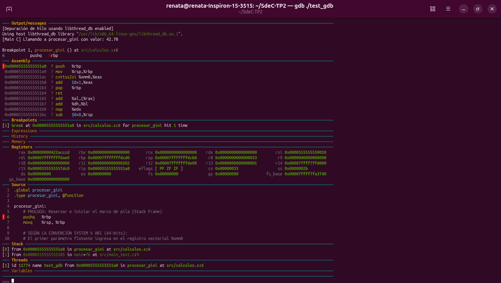
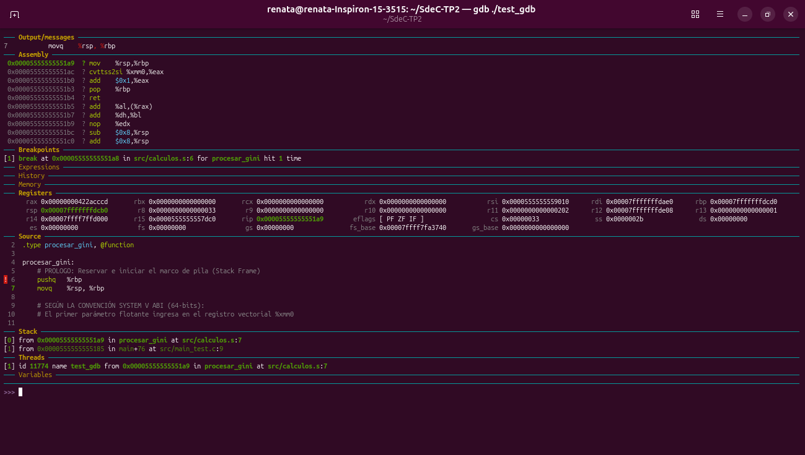
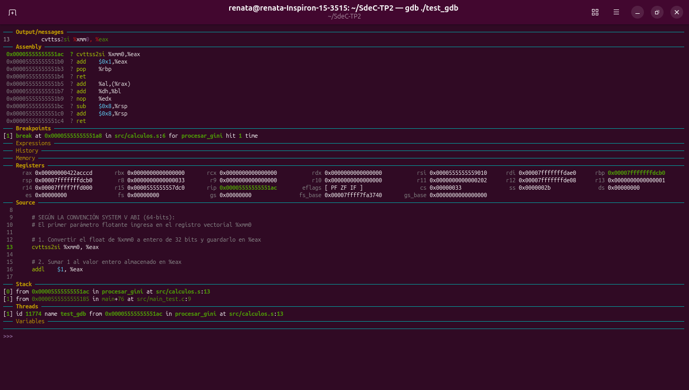
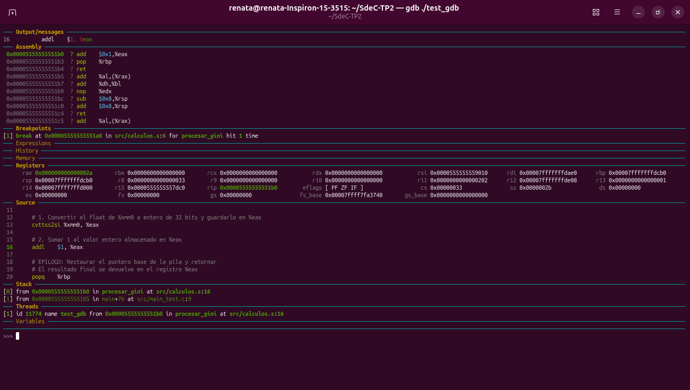
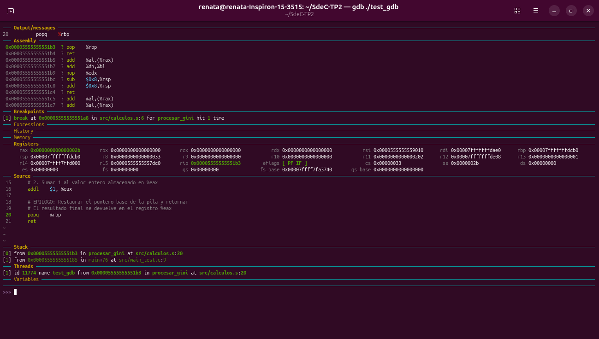
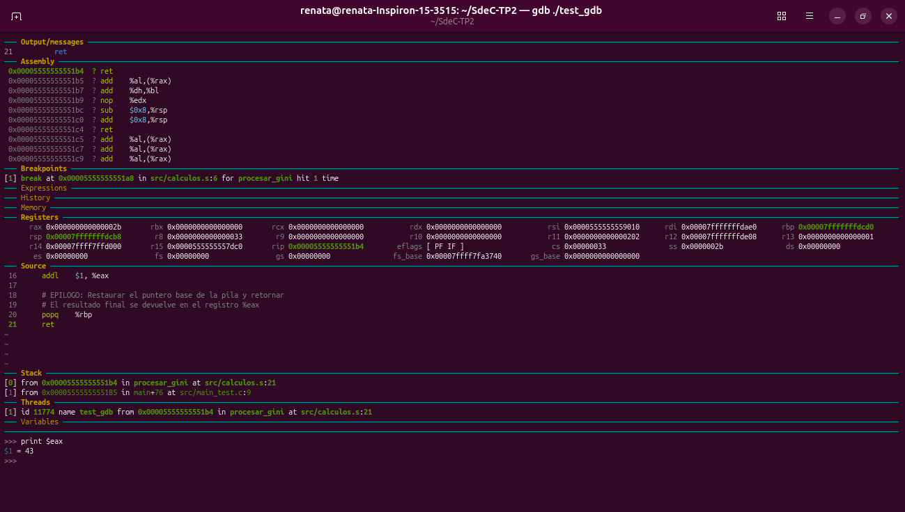

# Sistemas de Computación
# Trabajo Práctico 2 - Procesamiento Multicapa e Inspección del Stack Frame (Índice GINI)

**Integrantes:**
- Aguilar Bazán, Lautaro Ismael
- Faro, Tomás Martin
- Monaldi, Renata


---


## 1. Descripción del Proyecto y Arquitectura

Este proyecto implementa una solución en **arquitectura de tres capas** para obtener, transmitir y procesar el indicador socioeconómico **GINI** del Banco Mundial:

1. **Capa Superior (Python - Ingesta de datos API REST):**  
   Consume la API REST del Banco Mundial para recuperar el índice GINI en formato JSON (`https://api.worldbank.org/v2/en/country/all/indicator/SI.POV.GINI?...`). Los datos procesados se transfieren a la capa C mediante la librería estándar `ctypes`.

2. **Capa Intermedia (C - Puente/Wrapper):**  
   Gestiona el enlace dinámico y la llamada a bajo nivel mediante una librería compartida (`libpuente.so`), coordinando la transferencia de parámetros hacia la rutina en ensamblador.

3. **Capa Inferior (Ensamblador x86_64 - Lógica de Cómputo):**  
   Recibe el valor del índice GINI en punto flotante (`float`), realiza la conversión a entero truncado, le incrementa una unidad (`+1`) y devuelve el resultado final aplicando la convención de llamadas **System V AMD64 ABI**.

---

## 🛠️ 2. Requisitos del Sistema y Dependencias

Para la correcta compilación, enlace y depuración del sistema en entornos **Linux (x86_64)**, se requiere:

* **Compilador y Herramientas GNU:** `gcc` (soporte de 64 bits), `as` (GNU Assembler).
* **Entorno Python:** Python 3.8+ con el paquete `requests`.
* **Depurador:** `gdb` con interfaz visual `gdb-dashboard`.

Instalación de paquetes requeridos en Debian/Ubuntu:
   ```bash
   sudo apt update
   sudo apt install build-essential gdb python3 python3-pip
   pip install requests
   ```


---

## 3. Estructura del Repositorio

```text
TP2/
├── src/
│   ├── main.py          # Script de Python (Consulta API + Invocación Ctypes)
│   ├── puente.c         # Puente de enlace en C
│   ├── calculos.s       # Rutina en Assembly x86_64 (procesar_gini)
│   └── main_test.c      # Programa en C puro para inspección con GDB
├── .gitignore           # Exclusión de archivos binarios (.o, .so, test_gdb)
└── README.md            # Documentación general y evidencia
```

---

## 4. Compilación y Ejecución

### Opción A: Flujo Completo (Python → C → Assembly)

1. **Ensamblar el código x86_64:**

   ```bash
   as --64 -g -o src/calculos.o src/calculos.s

2. **Generar la librería dinámica compartida (.so):**
   
   ```bash
   gcc -shared -fPIC -g -o src/libpuente.so src/puente.c src/calculos.o

2. **Ejecutar el programa principal:**
   
   ```bash
   python3 src/main.py

### Opción B: Ejecución de Prueba en C Puro (Entorno GDB)

1. Para la verificación directa con el depurador:
   
   ```bash
   gcc -g -O0 -o test_gdb src/main_test.c src/calculos.o 
   ./test_gdb

---

## 5. Inspección Detallada del Stack Frame y Registros en GDB
Se realizó una sesión de depuración paso a paso (stepi) sobre el ejecutable test_gdb utilizando la interfaz GDB Dashboard para analizar el comportamiento del Stack Frame y los registros según el estándar System V AMD64 ABI.

**Datos de Entrada de la Prueba:**
* Parámetro flotante ingresado: 42.70
* Llamada desde C: procesar_gini(42.70) desde src/main_test.c

**Análisis Paso a Paso de la Rutina (src/calculos.s)**

1. Punto de Interrupción y Prólogo (procesar_gini - Dirección `0x00005555555551a8`)



- Instrucción a ejecutar: `pushq %rbp`
- **Estado inicial:**
  - El argumento `42.70` ingresa en el registro flotante `%xmm0` respetando la convención *System V ABI.*
  - El puntero de pila `%rsp` se encuentra en `0x00007fffffffdcb8`.
  - La pila indica que la función actual fue invocada desde main+76 (src/main_test.c).

2. Reservar Marco de Pila (`src/calculos.s`) 



- Instrucción: `movq %rsp, %rbp`
- **Modificación de Memoria:**
   - Al ejecutarse pushq `%rbp`, el puntero de la pila `%rsp` se desplaza en 8 bytes hacia direcciones más bajas, pasando de `0x00007fffffffdcb8` a `0x00007fffffffdcb0`.
   - Se guarda la dirección base del marco anterior en la cima de la pila y `%rbp` toma el valor de `%rsp` (0x00007fffffffdcb0) consolidando el nuevo Stack Frame.

3. Conversión de Flotante a Entero (`sr c/calculos.s`)



   - Instrucción: `cvttss2si %xmm0, %eax`
   - **Comportamiento:**
      - Toma el valor escalar `42.70` del registro `%xmm0`, realiza el truncamiento hacia cero y guarda la parte entera en el registro de 32 bits `%eax`.
      - El registro `%rax` actualiza su contenido a `0x000000000000002a` (donde `0x2a` en hexadecimal equivale exactamente a `42` en decimal).

4. Incremento Aritmético (src/calculos.s)



   - Instrucción: `addl $1, %eax`
   - **Comportamiento:**
      - Suma una unidad directa al contenido de `%eax`.
      - El valor de `%rax` cambia de `0x2a` (42) a `0x000000000000002b` (donde `0x2b` en hexadecimal equivale a **43** en decimal).

5. Epílogo y Limpieza del Stack (src/calculos.s)



   - Instrucciones: `popq %rbp` y `ret`
   - **Comportamiento:**
      - `popq %rbp` restaura el puntero base original del llamador (main) y restablece `%rsp` a `0x00007fffffffdcb8`.
      - `ret` desapila la dirección de retorno y devuelve la ejecución a main.

6. Verificación Final del Valor Devuelto



   - Al retornar a la función en C, se inspecciona el registro acumulador de salida:
   ```text
   (gdb) print $eax
   $1 = 43
   ```
   - **Conclusión:** Se verifica que la conversión truncada de `42.70` dio `42`, se le incrementó `1` dando como resultado final `43`, entregado correctamente a C a través del registro `%eax`.